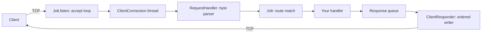
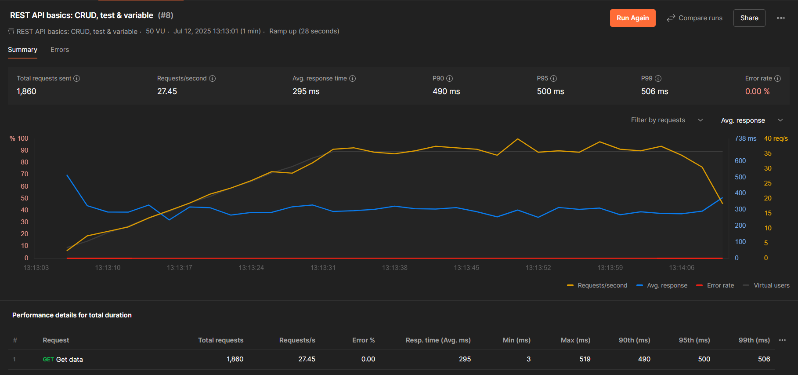

# Jolt

**An Express-style HTTP framework for Java, built from raw sockets.**

Write a Java web server the way you write one in Express.js, with no annotations, no beans and no container to learn first.

```java
Jolt.GET("/hello/:name", (req, res) -> {
    JSON body = new JSON();
    body.add("greeting", "Hello " + req.urlPathParams.get("name"));
    res.setBody(body);
});
Jolt.listen(8080, () -> System.out.println("up"));
```

> Status: **v0.1.0 (proof of concept)**. Jolt works and is load-tested, but it is not yet a library you can import. See [Where it is going](#where-it-is-going).

## The story

I learned backend development with Express.js. A route is one line and a server is ten. When I tried the same in Java, the standard answer was Spring Boot: annotations, dependency injection, auto-configuration and a lot of hidden machinery. It is powerful, but the entry barrier is high, and that is why many college students stay with Node.

So I asked: **what would a Java framework look like if it felt like Express?** To avoid hiding anything, I built it from the lowest level: a `ServerSocket`, and my own HTTP parser.

## How it was built

| Date | Milestone |
|---|---|
| 14 Jun 2025 | Maven project, JWT and Basic auth routines |
| 16 Jun | Authorization workflow tested end to end |
| 19 Jun | Multithreading for connections and requests, then the `Router` feature |
| 23 Jun | Second app on the framework: a webhook broadcast service |
| 29 Jun | Fixed the multiple-socket (keep-alive) issue |
| 12 Jul | Load-tested an API built with Jolt |
| 16-18 Jul | Path and query parameters, a handler bug, case-insensitive headers |
| 21 Jul | Parser rewritten from characters to **bytes**, to receive binary bodies |

Full details with evidence for each item are in [docs/KRA.md](docs/KRA.md).

## What works today

- **Express-like API:** `GET`, `POST`, `PUT`, `ALL`, `:param` path parameters and query parameters.
- **Routers:** build separate route groups and mount them with `Jolt.use("/auth", router)`.
- **Auth:** HTTP Basic (database-backed) and JWT (HS256).
- **Content:** JSON, HTML, text and images, with `Content-Type` and `Content-Length` handled for you.
- **HTTP/1.1:** keep-alive, pipelined requests answered in order, binary request bodies.
- **Two demo apps:** an attendance system and a webhook notification service.

## Architecture (v0.1.0)



## Numbers

Postman load test, 50 virtual users for 1 minute ([report](jolt-http-server/REST-API-basics--CRUD,-test-&-variable-performance-report-8.html)):

| Requests | Throughput | Avg response | Errors |
|---|---|---|---|
| 1,860 | 27.45 req/s | 295 ms | 0.00 % |



## What I learned

- HTTP is just bytes: a text request line, headers ending in `\r\n\r\n`, then a body. Treating a binary body as text corrupts it.
- Concurrency has to preserve order. Keep-alive clients can send several requests before the first answer, and responses must come back in order.
- Auth is mostly about failure modes: an expired token, a bad signature and a malformed token should all be told apart.
- Reviewing my own work honestly is worth more than the demo (next section).

## Where it is going

A review of v0.1.0 found real problems (15 are listed in [docs/KRA.md](docs/KRA.md#known-limitations-at-v010)): unbounded threads, sleep-polling, a middleware bug, hardcoded secrets, and no size limits or tests. The framework is also mixed in with the server, so it cannot be imported as a package.

**v1.0 goals**

1. **A real library.** Multi-module Maven: `jolt-core` with zero dependencies, optional `jolt-auth` and `jolt-mcp`, and examples kept separate.
2. **Safe by default.** Bounded virtual threads, request limits, timeouts, no default secrets.
3. **Tested.** An in-memory test client, protocol tests on a real socket, and a coverage gate.
4. **AI-native.** Jolt aims to be the cheapest Java framework for an AI agent to build with:
   - a compact `llms.txt` API cheat sheet,
   - a published token-count benchmark against Spring Boot and Javalin,
   - helpful one-line errors,
   - registered routes exposed as MCP tools.

## Getting started

Requirements: JDK 21 and Maven.

```bash
git clone https://github.com/THIRU-1074/custom-Http-Server.git
cd custom-Http-Server/jolt-http-server
mvn compile exec:java
```

The demo attendance app starts on port 5007. To build your own, replace `AttendanceApp` and `NotificationServer` and call your app from `Main`.

## Resources

- [MDN HTTP docs](https://developer.mozilla.org/en-US/docs/Web/HTTP), the best reference for the protocol.
- [jwt.io](https://jwt.io/) for debugging tokens.
- Postman for API and load testing.
