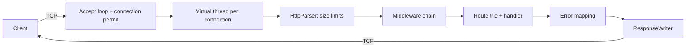

# Jolt

**An Express-style HTTP framework for Java, built from raw sockets.**

Write a Java web server the way you write one in Express.js: no annotations, no beans, no container to learn first. `jolt-core` has no runtime dependencies and needs JDK 21.

```java
var app = Jolt.create();
app.get("/hello/:name", (req, res) -> res.json(Map.of("greeting", "Hello " + req.param("name"))));
app.listen(8080);
```

## Install

Jolt is published through [JitPack](https://jitpack.io) (not yet on Maven Central, see [Roadmap](#roadmap)). Current release: `v0.3.1`.

```xml
<repositories>
  <repository>
    <id>jitpack.io</id>
    <url>https://jitpack.io</url>
  </repository>
</repositories>

<dependencies>
  <dependency>
    <groupId>com.github.THIRU-1074.custom-Http-Server</groupId>
    <artifactId>jolt-core</artifactId>
    <version>v0.3.1</version>
  </dependency>
</dependencies>
```

Optional modules use the same group and version:

| Module | Adds |
|---|---|
| `jolt-auth` | JWT (HS256), Basic auth, roles, `PasswordHasher`, refresh tokens. Uses `java-jwt`. |
| `jolt-mcp` | Routes tagged with `.tool(...)` become MCP tools |
| `jolt-db` | Small bounded JDBC pool with parameterized queries |
| `jolt-dev` | Dev-only restart runner and error page |
| `jolt-archetype` | `mvn archetype:generate` scaffold (see `llms-extras.txt`) |

`jolt-starter/` is a standalone todos project to copy and start from.

## The story

I learned backend development with Express.js. A route is one line and a server is ten. In Java the standard answer is Spring Boot: annotations, dependency injection, auto-configuration and a lot of hidden machinery. It is powerful, but the entry barrier is high, and it is why many college students stay with Node.

So I asked: **what would a Java framework look like if it felt like Express?** To hide nothing, I built it from the lowest level: a `ServerSocket` and my own HTTP parser (v0.1.0). A review of that version found 15 real problems (L1-L15). The code was then rewritten as a multi-module library and each problem was closed. The record is in [docs/KRA.md](docs/KRA.md).

## What it does

Full API sheets: [llms.txt](llms.txt) (core) and [llms-extras.txt](llms-extras.txt) (optional features). Design: [docs/ARCHITECTURE.md](docs/ARCHITECTURE.md).

| Area | Features |
|---|---|
| Routing and middleware | `get/post/put/delete/patch/head/options`, `:param`, `*`, regex constraints and optional params, `Router` mounting, route-level middleware, `RouteModule` and typed handlers, `onError` mappers |
| Request | Query, form, cookies, JSON into records, multipart, typed params (`req.param("id", Long.class)`), validation (422), JSON dates/UUID/enums/Optional |
| Response | `json/text/html/send/sendFile/redirect`, cookies, ETag and cache headers, static files with Range, gzip, HTML templating, content negotiation and codecs, problem+json (opt-in) |
| Security | Request limits, request-smuggling and header-injection rejection, path traversal protection, loopback bind by default, security headers, CORS, CSRF, signed sessions, rate limiting |
| Auth (`jolt-auth`) | JWT, Basic, role checks, PBKDF2 `PasswordHasher`, refresh tokens with reuse detection |
| Transport | HTTP/1.1 keep-alive and pipelining on virtual threads, TLS 1.2+, Expect: 100-continue, trusted-proxy headers, SSE and streaming, WebSocket |
| Observability | Request logger, request IDs, opt-in `/_jolt/health` and `/_jolt/metrics` (Prometheus text), route listing and OpenAPI |
| Tooling | `JoltTest` in-memory client, `jolt-dev` restart runner, archetype, `JoltConfig.fromEnv()` |

Risky features (CORS, route listing, metrics, MCP, TLS, static files) are off until enabled.



## AI-native

Jolt aims to be cheap for an AI coding tool to use correctly.

- [llms.txt](llms.txt): a core API cheat sheet (2062 tokens, limit 2100). Optional features live in [llms-extras.txt](llms-extras.txt) (2139 tokens, limit 3200).
- `JoltTest.of(app)`: requests without a socket, so an agent can test what it wrote.
- `jolt-mcp`: expose tagged routes as MCP tools. Checked with MCP Inspector 1.0.5 only.
- Agent identity: name the calling agent, audit every tool call and cap calls per agent with `McpOptions.agent`, `.audit` and `.budget`.
- Guards in CI: `LlmsTxtBudgetTest` and `token-guard.py`. `perf-guard.py` runs locally.

Token cost of the same todos API (auth, validation, one test), counted with tiktoken `cl100k_base` ([method and caveats](benchmarks/RESULTS.md)):

| Framework | Tokens |
|---|---:|
| Express | 789 |
| Jolt | 1017 |
| Javalin | 1172 |
| Spring Boot | 1320 |

Jolt is about 23% below Spring Boot and 13% below Javalin; Express is smaller than Jolt. The Jolt todo app (source plus pom, no tests) is 697 tokens and stayed there after 29 features, enforced by the token guard.

## Performance

Authenticated `GET /todos`, 50 clients, 20 s, 3 runs after warmup, via `benchmarks/guard/perf-guard.py`. One idle Windows machine (AMD Ryzen 5 5625U), JDK 24, client and server on the same host. Indicative only.

| Version | Median req/s |
|---|---:|
| v0.2.0 | 22,337 (runs 21.2k to 22.6k) |
| current main | 22,561 and 21,887 (two measurements) |

No regression within noise. In an earlier cross-framework run Jolt, Spring Boot and Javalin were statistically tied (run-to-run variance was larger than the gaps) and Express was about 5x lower. The v0.1.0 Postman test (50 VU, 1 min: 27.45 req/s, 295 ms average, [report](docs/baseline/v0.1-postman-report.html)) used a different tool, so it is not comparable. Linux and macOS were not measured.

## Project structure

```
jolt-core/        zero-dependency core (in.jolt, in.jolt.internal is not API)
jolt-auth/  jolt-mcp/  jolt-db/  jolt-dev/  jolt-archetype/
jolt-starter/     standalone todos project
examples/         todos-solid (SOLID reference)
benchmarks/       tokens, load, verify, guard, mcp, RESULTS.md
docs/             KRA, ARCHITECTURE, SOLID, PRINCIPLES, RELEASING, adr/
```

## Run the examples

Requires JDK 21 and Maven.

```bash
git clone https://github.com/THIRU-1074/custom-Http-Server.git
cd custom-Http-Server
mvn -B install -DskipTests
mvn -pl examples/todos-solid exec:java     # port 8080, or set PORT
```

The server binds to loopback by default (`JoltConfig.defaults()`). See [docs/examples.md](docs/examples.md). SOLID guide: [docs/SOLID.md](docs/SOLID.md).

## Contributing

Read [CONSTITUTION.md](CONSTITUTION.md) and [CONTRIBUTING.md](CONTRIBUTING.md). Activate the hooks with `git config core.hooksPath .githooks`. Every behavior change needs a test, public API growth needs an ADR in `docs/adr/`, and the size and speed guards are described in [benchmarks/guard/README.md](benchmarks/guard/README.md). AI tools follow [AGENTS.md](AGENTS.md).

Process so far: test-first features, atomic commits, ADRs 0001-0011 (two files share the number 0002) and a code review per branch with findings fixed before merging.

## Roadmap

- **Maven Central** ([#36](https://github.com/THIRU-1074/custom-Http-Server/issues/36), open): needs the owner's namespace verification, Central account and GPG key. Steps are in [docs/RELEASING.md](docs/RELEASING.md); the signing and deploy path has not been run.
- 29 of the 30 planned feature issues (#7-#36) are implemented and closed; #36 is the remaining one.

## Limitations

- Performance was measured on one Windows machine; Linux and macOS are unmeasured.
- The WebSocket implementation has not been run against the Autobahn conformance suite.
- TLS with client certificates is untested.
- `JoltTest` cannot stream or upgrade to WebSocket; use a real socket for those.
- Sessions are signed, not encrypted.
- Published only through JitPack.
