# Jolt server performance

Throughput and latency of the Jolt todo app, measured on **Jolt 0.4.2** and compared with the earlier
**0.2.0** run, which is kept unchanged in [RESULTS-0.2.0.md](RESULTS-0.2.0.md). Spring Boot, Javalin and
Express are measured the same way as reference points.

| | Jolt 0.2.0 (old) | Jolt 0.4.2 (new) |
|---|---|---|
| Measured | 2026-11-16 | 2026-11-25 |
| Mean throughput | 21,206 req/s | **21,512 req/s** |
| Mean latency | 2.47 ms | **2.33 ms** |
| Run-to-run spread | 16,178 to 25,604 req/s | **20,697 to 22,196 req/s** |
| Errors | 0 | 0 |

**Reading:** Jolt's average moved by about +1.4%, which is inside noise. What changed is steadiness:
the spread between the best and worst run shrank from about 9,400 req/s to about 1,500 req/s.
Spring Boot and Javalin were faster in this session, so Jolt now sits behind both. See
[Reading the results](#reading-the-results) before drawing conclusions.

---

## Setup

| | |
|---|---|
| Machine | AMD Ryzen 5 5625U (6 cores / 12 threads), 13.8 GB RAM, Windows 11 |
| JDK / Node | Oracle OpenJDK 24.0.1 (modules compiled with `--release 21`), Node v22.16.0 |
| Jolt | `in.jolt:jolt-core:0.4.2`, installed from this repo into the local Maven repository |
| Server JVMs | `-Xmx448m` for Jolt, Javalin and Spring Boot |
| Client | `benchmarks/load/Load.java`: 50 virtual-thread clients, JDK `HttpClient`, HTTP/1.1 |
| Request | `GET /todos` with `Authorization: Bearer secret`, empty list |
| Duration | 30 s per run, 3 consecutive runs per app on one JVM, apps started fresh and run one at a time |

Client and server share one machine, so the client competes with the server for CPU.

```
java benchmarks/load/Load.java http://localhost:8080/todos 50 30 "Authorization: Bearer secret"
```

---

## Throughput, averaged over runs

Each block is about 1,000 req/s.

```
                      old (0.2.0 run)                      new (0.4.2 run)
Jolt        |||||||||||||||||||||  21.2k        |||||||||||||||||||||| 21.5k
Spring Boot |||||||||||||||||| 17.7k            ||||||||||||||||||||||||| 24.1k
Javalin     ||||||||||||||||  15.8k              ||||||||||||||||||||||||| 24.8k
Express     |||| 3.4k                            |||| 4.0k
```



```mermaid
xychart-beta
    title "Mean throughput (req/s), old run vs new run"
    x-axis ["Jolt", "Spring Boot", "Javalin", "Express"]
    y-axis "req/s" 0 --> 28000
    bar [21206, 17678, 15817, 3405]
    bar [21512, 24079, 24804, 4024]
```

First bar of each pair: old run (Jolt 0.2.0 session). Second bar: new run (Jolt 0.4.2 session).

## Old versus new, side by side

| Framework | Old mean req/s | New mean req/s | Change | Old mean latency | New mean latency |
|---|---:|---:|---:|---:|---:|
| **Jolt** | 21,206 | **21,512** | +1.4% | 2.47 ms | **2.33 ms** |
| Spring Boot | 17,678 | 24,079 | +36.2% | 2.87 ms | 2.07 ms |
| Javalin | 15,817 | 24,804 | +56.8% | 3.15 ms | 2.03 ms |
| Express | 3,405 | 4,024 | +18.2% | 14.7 ms | 12.4 ms |

Competitor rows moved a lot between sessions while Jolt barely did. That points at session conditions
(background load, thermal state, JIT luck) as much as at the code, so the old and new competitor rows
should not be read as framework improvements.

## Jolt against the others in the new run

| Framework | Mean req/s | Versus Jolt | Mean latency |
|---|---:|---:|---:|
| Javalin | 24,804 | Jolt is 13.3% lower | 2.03 ms |
| Spring Boot | 24,079 | Jolt is 10.7% lower | 2.07 ms |
| **Jolt** | **21,512** | baseline | **2.33 ms** |
| Express | 4,024 | Jolt is 5.3x higher | 12.4 ms |

In the old run Jolt led Spring Boot by 20% and Javalin by 34%, but with a 9,400 req/s spread in Jolt's own
runs, that lead was not reliable either.

---

## Every run

### Jolt 0.4.2 (new)

| Run | Requests | req/s | Mean latency | Failed |
|---:|---:|---:|---:|---:|
| 1 | 649,392 | 21,644 | 2.3 ms | 0 |
| 2 | 620,979 | 20,697 | 2.4 ms | 0 |
| 3 | 665,957 | 22,196 | 2.3 ms | 0 |

### Reference frameworks (new)

| App | Run | req/s | Mean latency | Failed |
|---|---:|---:|---:|---:|
| Javalin | 1 | 24,124 | 2.1 ms | 0 |
| Javalin | 2 | 26,225 | 1.9 ms | 0 |
| Javalin | 3 | 24,063 | 2.1 ms | 0 |
| Spring Boot | 1 | 24,090 | 2.1 ms | 0 |
| Spring Boot | 2 | 23,729 | 2.1 ms | 0 |
| Spring Boot | 3 | 24,419 | 2.0 ms | 0 |
| Express | 1 | 3,883 | 12.9 ms | 0 |
| Express | 2 | 4,086 | 12.2 ms | 0 |
| Express | 3 | 4,103 | 12.2 ms | 0 |

### Old run (Jolt 0.2.0), for comparison

| App | Run | req/s | Mean latency |
|---|---:|---:|---:|
| Jolt | 1 | 16,178 | 3.1 ms |
| Jolt | 2 | 25,604 | 2.0 ms |
| Jolt | 3 | 21,836 | 2.3 ms |
| Spring Boot | 1 | 20,657 | 2.4 ms |
| Spring Boot | 2 | 16,357 | 3.1 ms |
| Spring Boot | 3 | 16,021 | 3.1 ms |
| Javalin | 1 | 16,111 | 3.1 ms |
| Javalin | 2 | 15,523 | 3.2 ms |
| Express | 1 | 3,405 | 14.7 ms |

---

## History

| Version | Tool | req/s | Mean latency |
|---|---|---:|---:|
| v0.1 | Postman, 50 VU, 1 min | 27.45 | 295 ms |
| 0.2.0 | `Load.java`, 50 clients, 30 s | 21,206 | 2.47 ms |
| 0.4.2 | `Load.java`, 50 clients, 30 s | 21,512 | 2.33 ms |

The v0.1 figure used a different tool, route and client. Do not read the jump from v0.1 as a pure framework
improvement.

---

## Reading the results

- **Spring Boot's first launch (discarded run).** Spring Boot's first session in this round had a third run that took 1,481 s
  instead of 30 s, with 47 failures and 458 req/s. The machine appears to have stalled or slept, so the run is not a
  measurement of the server. Spring Boot was relaunched from scratch and the three runs above are from that relaunch.
  Its first two runs before the stall were 20,975 and 23,533 req/s, in line with the relaunch.
- **Jolt is steadier, not demonstrably faster.** The mean difference (+1.4%) is smaller than the spread
  between Jolt's own runs, so the throughput change is not significant. The narrower spread is the clearer signal.
- **Jolt trails Javalin and Spring Boot by 11 to 13% in this session.** That gap is larger than Jolt's new run-to-run
  spread (about 3.5% either side of the mean), so it is likely real for this setup. The earlier 0.2.0 session showed
  the opposite order, so the ranking depends on the session. Repeat on a quiet machine before quoting it.
- **No cause is claimed.** This run does not isolate which change between 0.2.0 and 0.4.2 affected the numbers.
  The 0.4.x line changed connection handling (virtual threads, a keep-alive poller), but no profiling was done here.

## Not measured

- One route (`GET /todos`, empty list): no body parsing, no writes, no larger payloads.
- No latency percentiles (only the mean), no memory or CPU use, no TLS, no HTTP keep-alive tuning comparison.
- Client and server on one machine; no warm-up control beyond three consecutive runs.
- Token counts and behaviour checks are unchanged from [RESULTS-0.2.0.md](RESULTS-0.2.0.md) and were not repeated here.

## Reproduce

```
mvn -DskipTests install                        # Jolt 0.4.2 into the local repository
cd benchmarks/tokens/jolt    && mvn package dependency:build-classpath -Dmdep.outputFile=target/cp.txt
cd benchmarks/tokens/javalin && mvn package dependency:build-classpath -Dmdep.outputFile=target/cp.txt
cd benchmarks/tokens/spring  && mvn package
cd benchmarks/tokens/express && npm install

java -Xmx448m -cp "target/classes;$(cat target/cp.txt)" todo.TodoApp     # from the app's directory
java benchmarks/load/Load.java http://localhost:8080/todos 50 30 "Authorization: Bearer secret"
```

Run each app on its own, three times in a row, and stop it before starting the next.
