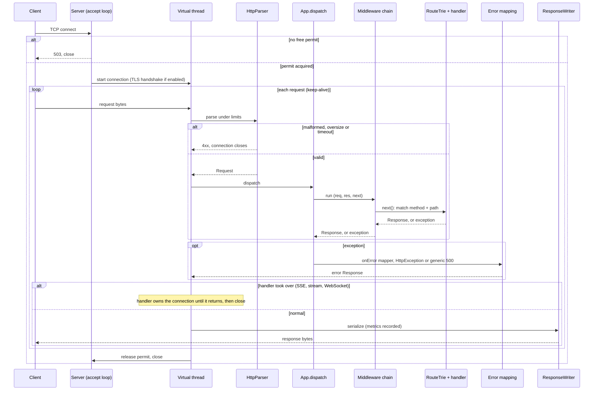
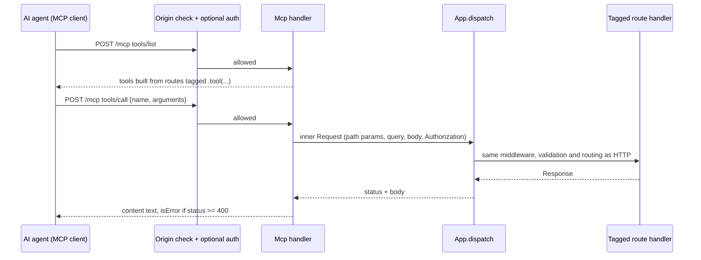

# Architecture

This describes Jolt as of v0.4.1. Packages named `internal` are not API and may change without notice.

## Module map

```
pom.xml                      parent (Java 21, Spotless, JUnit 5, JaCoCo; inactive release profile)
jolt-core/                   zero runtime dependencies; the only module users must import
  in.jolt                    Jolt, App, Router, Request, Response, Handler, Middleware, JoltConfig,
                             Server, HttpException, HttpStatus, Typed, Params, Reply, RouteModule,
                             Validate/Validator/Rules, Static, Compress, Cors, Csrf, Sessions,
                             SecurityHeaders, RateLimit, RequestId, Logger, BodyCodec, JsonMapper,
                             EventStream, ResponseStream, WebSocketHandler/Route/Session, Multipart,
                             Hub (pub/sub for SSE and WebSocket), TtlCache, Idempotency, Webhooks,
                             Config, Page, AppMetrics, Route (carries the MCP tool description)
  in.jolt.internal.http      HttpParser, ConnectionHandler, ResponseWriter, Limits, Replies, Tls,
                             TrustedProxies, Metrics, StreamGuard, WebSocketConnection
  in.jolt.internal.routing   RouteTrie, Suggest (did-you-mean 404)
  in.jolt.internal.json      Json, BuiltInJsonMapper (behind the JsonMapper SPI)
  in.jolt.internal.openapi   OpenApi
  in.jolt.internal.view      Views (templating)
  in.jolt.test               JoltTest (in-memory test client; public)
jolt-auth/                   JwtAuth, BasicAuth, Auth (roles), PasswordHasher, RefreshTokens,
                             RefreshStore (depends on core and java-jwt)
jolt-mcp/                    Mcp, McpOptions: tagged routes as MCP tools (depends on core only)
jolt-db/                     Db, Sql, Migrations, TxMode: bounded JDBC pool, parameterized queries,
                             transactions, versioned migrations
                             (JDK java.sql only; sqlite-jdbc is test scope)
jolt-dev/                    Dev (restart runner), DevErrors (opt-in error page)
jolt-archetype/              Maven archetype generating the starter project (ships AGENTS.md, llms.txt)
jolt-starter/                standalone todos project (not in the reactor)
examples/todos-solid         SOLID reference app (domain, adapters, web, composition root)
benchmarks/                  tokens, load, verify, guard, mcp
```

## Request lifecycle

1. `Jolt.create(config)` builds an `App` (a `Router` that can listen). `listen(port)` opens a `ServerSocket`, or a TLS one when `JoltConfig.tls` is set, binds to loopback by default, starts the accept loop and returns a `Server`.
2. Each accepted connection acquires a permit from `Semaphore(maxConnections)`. Without a permit the connection gets a 503 and is closed.
3. A virtual thread (`newVirtualThreadPerTaskExecutor`) owns the connection and handles its requests one after another, which keeps HTTP/1.1 responses in order. Over TLS the handshake runs first. A connection closes after `keepAliveTimeout` idle, after `maxRequestsPerConnection`, or when the server is draining.
4. `HttpParser` enforces the limits (request line, header bytes and count, body bytes), reads exactly `Content-Length` bytes or a chunked body, rejects request-smuggling vectors, and answers `Expect: 100-continue` once framing is valid. Malformed, oversize or slow input gets a 4xx (400, 408, 413, 414, 431 and others) and the connection closes.
5. `TrustedProxies` builds the `Request`: `X-Forwarded-*` is applied only for peers listed in `trustProxy`.
6. `App.dispatch` runs the global middleware (registered with `use`, in order) and then route resolution. `RouteTrie` matches method and path (static, then regex-constrained, then plain `:param`, then `*`) and binds parameters. No match gives a 404 with a did-you-mean hint; a known path with another method gives 405 with `Allow`. Route-level middleware and the handler are the last links. `HEAD` falls back to `GET`.
7. A typed handler (`Typed.Read`, `Write`, `Run`) binds params and a JSON body, calls your function and turns the result or `Reply` into a response. A bad body is 400 and a failed validation is 422.
8. Errors: `ConnectionHandler.respond` catches any throwable. A registered `onError` mapper (closest type wins) decides the reply, an `HttpException` keeps its status, and anything else becomes a generic 500 with no details; the stack trace goes to the logger. Headers set by middleware (CORS, security headers, cookies) are kept on error replies. With `problemJson(true)`, 4xx and 5xx replies use `application/problem+json`, with `requestId` when `RequestId` is installed. Mappers may take the request too (`(e, req) -> ...`). Stock auth and rate-limit middleware reject by throwing `HttpException`, so they take the same path (ADR 0024). The in-memory `JoltTest` uses the same `respond` path.
9. If the handler opened a stream (`res.sse()`, `res.stream()`) or a WebSocket (`app.ws`), the connection is taken over: the handler keeps the connection thread, `StreamGuard` applies the idle and maximum-duration timeouts, and the connection closes when the handler returns. Otherwise `ResponseWriter` serializes the response (rejecting CR/LF in header names and values) and the loop continues or closes.
10. When `exposeMetrics()` is on, `Metrics` records method, final status class, latency, connection and stream counts and body bytes for each non-streaming request.



## AI-native features

Jolt is designed to be cheap for an AI coding agent to use correctly, and to let an agent call a running Jolt app. Everything here is on `main` (v0.4.1).

| Feature | Where | What it does |
|---|---|---|
| `llms.txt` | repo root, and bundled in the `jolt-core` jar as `META-INF/llms.txt` | The whole core API as one cheat sheet an agent reads before writing code: 2092 of 2100 tokens (cl100k_base) |
| `llms-extras.txt` | repo root, and `META-INF/llms-extras.txt` | Optional features (auth, db, MCP, streaming, archetype): 3180 of 3200 tokens |
| MCP server | `jolt-mcp`: `Mcp.expose(app, "/mcp", McpOptions)` | Routes tagged `.tool("description")` become MCP tools that any MCP client can list and call (verified with MCP Inspector 1.0.5) |
| In-memory testing | `in.jolt.test.JoltTest` | `JoltTest.of(app)` sends requests with no socket, so an agent can test what it wrote in the same step |
| Agent scaffolding | `jolt-archetype`, `jolt-starter` | Generated projects include `AGENTS.md` (rules for coding agents) and `llms.txt` |
| Introspection | `app.exposeRoutes()` | Opt-in `GET /_jolt/routes` and `GET /_jolt/openapi.json`, so tools can discover the API |
| Self-correcting errors | `Suggest`, `problemJson(true)`, `onError` | A 404 carries a did-you-mean hint; errors are `application/problem+json` with `requestId`, which an agent can parse |
| Dev error page | `jolt-dev`: `DevErrors.page()` | With `JOLT_DEV` set, exceptions render with stack traces; production is unchanged |
| Guards | `LlmsTxtBudgetTest`, `LlmsExtrasBudgetTest`, `benchmarks/guard/token-guard.py` | CI fails if the cheat sheets or the reference todo app (697 tokens, +5% allowed) grow past their budgets |

### MCP tool flow

`jolt-mcp` speaks MCP protocol `2025-06-18` over Streamable HTTP (JSON-RPC 2.0 on `POST`), and handles `initialize`, `ping`, `tools/list` and `tools/call`. It depends on `jolt-core` only.

- **Tools come from routes.** `app.get("/todos/:id", h).tool("Get one todo")` tags a route; `Mcp` names it `get_todos_id` and builds an input schema from the path params, plus `query` and, for `POST`/`PUT`/`PATCH`, `body`.
- **Calls take the normal path.** `tools/call` builds an inner `Request` and runs `app.dispatch`, so the tool goes through the same middleware, auth, validation and error mapping as an HTTP client. The caller's `Authorization` and `Cookie` headers are forwarded.
- **Secure by default.** Nothing is exposed until `Mcp.expose` is called. Browser `Origin`s are rejected with 403 unless listed in `McpOptions.allowOrigins`, and `McpOptions.auth(middleware)` can require a token.
- **Errors stay readable.** A status of 400 or above comes back as `isError` content `HTTP <status>: <body>`.



Not on `main` yet: branch `feat/agent-safety` adds agent identity, a tool-call audit log, per-agent call budgets, typed JSON Schema for record inputs with `structuredContent` results, and W3C `traceparent` support.

## Key selling points

1. **Express-style Java.** Routes, middleware and routers are plain lambdas: no annotations, no beans, no container to learn first.
2. **Zero-dependency core.** `jolt-core` uses the JDK only (Java 21, virtual threads); auth, MCP, db and dev tools are separate optional modules.
3. **Cheapest Java framework for an AI agent to write.** The same todos API costs 1017 tokens in Jolt against 1172 in Javalin and 1320 in Spring Boot (Express is 789). Budgets on `llms.txt` and the reference app are enforced in CI.
4. **AI agents can call your app.** One line (`Mcp.expose`) turns tagged routes into MCP tools that run through your normal auth and validation.
5. **Secure by default.** Every parser limit is on, the server binds to loopback, and risky features (CORS, route listing, metrics, MCP, TLS, static files) are opt-in.
6. **Production features built in.** JWT and refresh tokens, rate limits, CSRF, idempotency keys, webhook signatures, SSE and WebSocket with a pub/sub hub, TTL cache, scheduled tasks, metrics and health checks, migrations.
7. **Competitive throughput.** About 22k req/s on one laptop for an authenticated `GET`, statistically tied with Spring Boot and Javalin in the same run ([benchmarks/RESULTS.md](../benchmarks/RESULTS.md)).
8. **Proven by a real app.** BookMyShow on Jolt drives the roadmap: each gap it hits becomes an issue (`from-bms`) and an ADR; 0.4.0 and 0.4.1 shipped 18 of them.

## Design patterns

| Pattern | Where |
|---|---|
| Chain of Responsibility | Middleware `(req, res, next)`; route-level middleware via `Middleware.then` |
| Composite | `Router` mounted into `App` or into other routers; `RouteModule` groups routes for one feature |
| Strategy | `JsonMapper`, `BodyCodec`, `ErrorMapper` (via `onError`), `RefreshStore` |
| Builder | `JoltConfig` (immutable, fluent copies), fluent `Response`, `McpOptions`, `SecurityHeaders`, `Sessions` |
| Facade | `Jolt` and `App` hide the parser, executor, TLS and writer |
| Trie | `RouteTrie`: matching in O(path segments) with `:param`, regex constraints, optional params and `*` |
| Dependency inversion | No DI container: collaborators are passed by constructor and wired in `main`; see [SOLID.md](SOLID.md) |

## API shape

```java
var app = Jolt.create(JoltConfig.defaults());
app.get("/users/:id", (req, res) -> res.json(repo.find(req.param("id"))));
app.use("/auth", authRouter);
app.listen(8080);
```

Risky features (CORS, route listing, metrics, MCP, TLS, static files) are opt-in. The full API is in [llms.txt](../llms.txt) and [llms-extras.txt](../llms-extras.txt); public API growth is recorded in the [ADRs](adr/).
