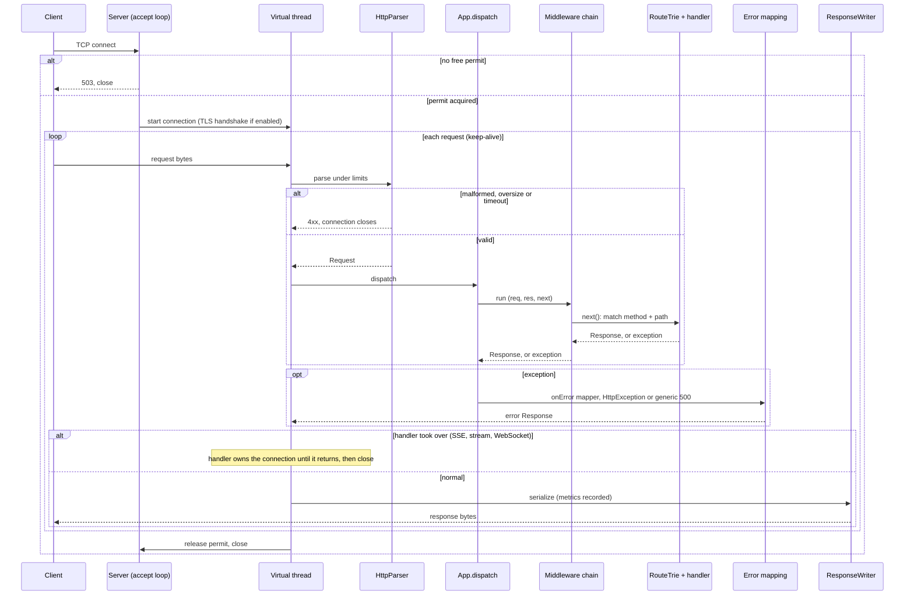

# Architecture

This describes Jolt as of v0.3.1. Packages named `internal` are not API and may change without notice.

## Module map

```
pom.xml                      parent (Java 21, Spotless, JUnit 5, JaCoCo; inactive release profile)
jolt-core/                   zero runtime dependencies; the only module users must import
  in.jolt                    Jolt, App, Router, Request, Response, Handler, Middleware, JoltConfig,
                             Server, HttpException, HttpStatus, Typed, Params, Reply, RouteModule,
                             Validate/Validator/Rules, Static, Compress, Cors, Csrf, Sessions,
                             SecurityHeaders, RateLimit, RequestId, Logger, BodyCodec, JsonMapper,
                             EventStream, ResponseStream, WebSocketHandler/Route/Session, Multipart,
                             Tasks
  in.jolt.internal.http      HttpParser, ConnectionHandler, ResponseWriter, Limits, Replies, Tls,
                             TrustedProxies, Metrics, StreamGuard, WebSocketConnection
  in.jolt.internal.routing   RouteTrie, Suggest (did-you-mean 404)
  in.jolt.internal.json      Json, BuiltInJsonMapper (behind the JsonMapper SPI)
  in.jolt.internal.openapi   OpenApi
  in.jolt.internal.view      Views (templating)
  in.jolt.test               JoltTest (in-memory test client; public)
jolt-auth/                   JwtAuth, BasicAuth, Auth (roles), PasswordHasher, RefreshTokens,
                             RefreshStore (depends on core and java-jwt)
jolt-mcp/                    Mcp, McpOptions: tagged routes as MCP tools (depends on core only)
jolt-db/                     Db: bounded JDBC pool, parameterized queries, transactions
                             (JDK java.sql only; sqlite-jdbc is test scope)
jolt-dev/                    Dev (restart runner), DevErrors (opt-in error page)
jolt-archetype/              Maven archetype generating the starter project
jolt-starter/                standalone todos project (not in the reactor)
examples/todos-solid         SOLID reference app (domain, adapters, web, composition root)
benchmarks/                  tokens, load, verify, guard, mcp
```

## Request lifecycle

1. `Jolt.create(config)` builds an `App` (a `Router` that can listen). `listen(port)` opens a `ServerSocket`, or a TLS one when `JoltConfig.tls` is set, binds to loopback by default, starts the accept loop and returns a `Server`.
2. Each accepted connection acquires a permit from `Semaphore(maxConnections)`. Without a permit the connection gets a 503 and is closed.
3. A virtual thread (`newVirtualThreadPerTaskExecutor`) owns the connection and handles its requests one after another, which keeps HTTP/1.1 responses in order. Over TLS the handshake runs first. A connection closes after `keepAliveTimeout` idle, after `maxRequestsPerConnection`, or when the server is draining.
4. `HttpParser` enforces the limits (request line, header bytes and count, body bytes), reads exactly `Content-Length` bytes or a chunked body, rejects request-smuggling vectors, and answers `Expect: 100-continue` once framing is valid. Malformed, oversize or slow input gets a 4xx (400, 408, 413, 414, 431 and others) and the connection closes.
5. `TrustedProxies` builds the `Request`: `X-Forwarded-*` is applied only for peers listed in `trustProxy`.
6. `App.dispatch` runs the global middleware (registered with `use`, in order) and then route resolution. `RouteTrie` matches method and path (static, then regex-constrained, then plain `:param`, then `*`) and binds parameters. No match gives a 404 with a did-you-mean hint; a known path with another method gives 405 with `Allow`. Route-level middleware and the handler are the last links. `HEAD` falls back to `GET`.
7. A typed handler (`Typed.Read`, `Write`, `Run`) binds params and a JSON body, calls your function and turns the result or `Reply` into a response. A bad body is 400 and a failed validation is 422.
8. Errors: `ConnectionHandler.respond` catches any throwable. A registered `onError` mapper (closest type wins) decides the reply, an `HttpException` keeps its status, and anything else becomes a generic 500 with no details; the stack trace goes to the logger. Headers set by middleware (CORS, security headers, cookies) are kept on error replies. With `problemJson(true)`, 4xx and 5xx replies use `application/problem+json`. The in-memory `JoltTest` uses the same `respond` path.
9. If the handler opened a stream (`res.sse()`, `res.stream()`) or a WebSocket (`app.ws`), the connection is taken over: the handler keeps the connection thread, `StreamGuard` applies the idle and maximum-duration timeouts, and the connection closes when the handler returns. Otherwise `ResponseWriter` serializes the response (rejecting CR/LF in header names and values) and the loop continues or closes.
10. When `exposeMetrics()` is on, `Metrics` records method, final status class, latency, connection and stream counts and body bytes for each non-streaming request.



## Design patterns

| Pattern | Where |
|---|---|
| Chain of Responsibility | Middleware `(req, res, next)`; route-level middleware via `Middleware.then` |
| Composite | `Router` mounted into `App` or into other routers; `RouteModule` groups routes for one feature |
| Strategy | `JsonMapper`, `BodyCodec`, `ErrorMapper` (via `onError`), `RefreshStore` |
| Builder | `JoltConfig` (immutable, fluent copies), fluent `Response`, `McpOptions`, `SecurityHeaders`, `Sessions` |
| Facade | `Jolt` and `App` hide the parser, executor, TLS and writer |
| Trie | `RouteTrie`: matching in O(path segments) with `:param`, regex constraints, optional params and `*` |
| Dependency inversion | No DI container: collaborators are passed by constructor and wired in `main`; see [SOLID.md](SOLID.md) |

## API shape

```java
var app = Jolt.create(JoltConfig.defaults());
app.get("/users/:id", (req, res) -> res.json(repo.find(req.param("id"))));
app.use("/auth", authRouter);
app.listen(8080);
```

Risky features (CORS, route listing, metrics, MCP, TLS, static files) are opt-in. The full API is in [llms.txt](../llms.txt) and [llms-extras.txt](../llms-extras.txt); public API growth is recorded in the [ADRs](adr/).
